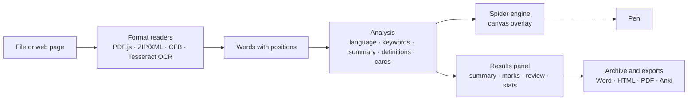

<div align="center">


# Word Crawler

**A spider that reads for you.** It underlines, circles and summarises documents and web pages, builds review cards and maps your disk — with statistics, not AI.

[](https://github.com/davide0707/word-crawler/actions/workflows/ci.yml)
[](https://github.com/davide0707/word-crawler/releases)


[](LICENSE)

**English** · [Italiano](README.it.md)


</div>

## Contents

- [Highlights](#highlights)
- [Screenshots](#screenshots)
- [Download](#download)
- [How it works](#how-it-works)
- [Formats and languages](#formats-and-languages)
- [Privacy and security](#privacy-and-security)
- [Development](#development)
- [Project status](#project-status)
- [License](#license)

## Highlights

| | |
|---|---|
| **Reads everything** | PDF (scanned ones too, via OCR), Word (.docx and legacy .doc), OpenDocument, PowerPoint, Excel, EPUB, RTF, HTML, Markdown, plain text, subtitles, CSV, images and live web pages. |
| **Marks what matters** | Underlines key sentences and definitions, circles names and concepts, boxes numbers and dates — and draws it all with an animated spider. |
| **Summarises without AI** | Keywords from YAKE-style statistics, word-frequency rarity and a co-occurrence graph; extractive summary with TextRank and MMR. Every figure is computed, nothing is generated. |
| **Helps you study** | Flashcards from definitions, fill-in-the-blank cards from key sentences, a multiple-choice quiz and Anki export. |
| **Your own pen** | Highlight, underline, annotate and erase, on PDFs and web pages too. |
| **Exports the marked document** | Word (.docx, with your notes as comments), HTML and PDF, plus Markdown, text, JSON and Anki summaries. |
| **Remembers pages** | The browser extension restores your marks when you reopen a saved page. |
| **Maps your disk** | Read-only scanner with a zoomable treemap, duplicates, largest files and folders, scan-to-scan comparison and a safe "move duplicates to Trash". |
| **Handles long documents** | Analysis runs in a Web Worker and PDF pages are extracted in parallel: about 25,000 words read and analysed in 1.3 s. |

The user interface is in Italian. Documents can be in Italian, English, French, Spanish, German or Portuguese.

## Screenshots

| | |
|:---:|:---:|
| <br>**Review cards and quiz** | <br>**Pen: highlights and notes** |
| <br>**OCR on scanned PDFs** | <br>**Paper theme** |
| <br>**Disk scanner** | <br>**Treemap** |
| <br>**Duplicates to the Trash** | <br>**Scan comparison** |
| <br>**Extension: marks restored** | <br>**Archive** |

## Download

Ready-made builds are published on the [**Releases**](https://github.com/davide0707/word-crawler/releases) page.

| Platform | File | Notes |
|---|---|---|
| Windows 10/11 | `Word-Crawler-Setup-<version>.exe` | Installer. A portable `.exe` that needs no installation is also provided. |
| macOS 11+ | `Word-Crawler-<version>-arm64.dmg` / `-x64.dmg` | Apple silicon and Intel. |
| Linux | `.AppImage` or `.deb` | x64. |
| Chrome, Edge, Brave | `word-crawler-extension.zip` | Unzip, open `chrome://extensions`, enable *Developer mode*, *Load unpacked*. |

Unsigned builds show a warning the first time: on Windows choose *More info → Run anyway*; on macOS right-click the app and choose *Open*. Signed builds are produced automatically when signing certificates are configured (see [Code signing](#code-signing)).

## How it works



One shared engine (`core/`) powers both the desktop app and the browser extension. A full description of the algorithms, the module map and the security model is in [docs/ARCHITECTURE.md](docs/ARCHITECTURE.md).

## Formats and languages

| Documents | Notes |
|---|---|
| PDF | Text PDFs through PDF.js; pages without text are recognised with Tesseract OCR |
| Word | .docx, .docm, .dotx and legacy .doc (Word 97–2003) |
| OpenDocument | .odt, .odp, .ods |
| Office | .pptx, .xlsx |
| Books and markup | EPUB, RTF, HTML, Markdown |
| Text | .txt (UTF-8, UTF-16, Windows-1252), .srt/.vtt subtitles, CSV/TSV |
| Images | PNG, JPG, WebP, BMP, GIF (OCR) |

| Language | Readability index | Stopwords, abbreviations, definitions | Word frequencies |
|---|---|---|---|
| Italian | Gulpease | yes | 20,000 words |
| English | Flesch Reading Ease | yes | 20,000 words |
| French | Kandel–Moles | yes | 20,000 words |
| Spanish | Szigriszt–Pazos | yes | 20,000 words |
| German | Amstad | yes, with common-noun detection | 20,000 words |
| Portuguese | Flesch (Martins) | yes | 20,000 words |

## Privacy and security

- **Local by design.** Documents never leave the computer and there is no telemetry. The only network access the app makes on its own is the first-time download of OCR language data (2–4 MB per language, from `cdn.jsdelivr.net`), and only when a scanned page or image is opened.
- **Hardened desktop app.** Context isolation, sandboxed renderer, a strict Content Security Policy, an internal `app://` protocol and a minimal preload bridge whose inputs are validated in the main process.
- **Read-only scanner.** The disk scan only lists, measures and reads files. Moving duplicates to the Trash is a separate action that only accepts files found by that scan inside the scanned folder, always keeps one copy per group, verifies byte-for-byte identity with SHA-256, asks for confirmation and writes a log.
- **Safe exports.** Marked-up PDFs are printed from a hidden window with JavaScript disabled.

Please report vulnerabilities privately as described in [SECURITY.md](SECURITY.md).

## Development

Requirements: **Node.js 20+** (22 recommended, see `.nvmrc`). No build step: the engine is plain JavaScript that runs unchanged in Electron, in the extension and in Node.

```bash
git clone https://github.com/davide0707/word-crawler.git
cd word-crawler
npm install          # Electron, PDF.js, Tesseract and the test tools
npm start            # run the desktop app
```

| Script | What it does |
|---|---|
| `npm start` | Runs the desktop app |
| `npm test` | Project checks plus the unit, integration and browser suites |
| `npm run lint` | Syntax, line endings, headers, JSON and version consistency |
| `npm run test:extension` | Loads the real extension in Chromium (needs a display; use `xvfb-run -a` on headless Linux) |
| `npm run test:ui -- <folder>` | End-to-end run of the desktop UI with a real scan, saving screenshots |
| `npm run build:extension` | Builds `dist/word-crawler-extension.zip` with PDF.js and Tesseract |
| `npm run dist` | Packages the desktop app for the current OS into `dist/` |
| `npm run fixtures` / `fixtures:ocr` | Regenerates the test documents (LibreOffice, pandoc) and OCR pages (Tesseract) |

### Project structure

```
core/                 shared engine: languages, formats, analysis, OCR, spider, pen, reader, exports
  freq/               word-frequency lists (CC BY-SA 4.0)
desktop/              Electron main process, preload bridge, disk scanner, scan tools
  ui/                 desktop window: tabs, scanner view, report, guide
extension/            Chrome/Edge/Brave extension (Manifest V3)
scripts/              extension build, project checks, ZIP writer
tests/                test suites, fixtures and test doubles
docs/                 architecture and images
.github/              CI, release workflow, issue and PR templates
```

### Testing

102 automated checks cover analysis in six languages, every document format, exports (Word files are validated by unzipping them), OCR mapping against real Tesseract output, the disk scanner and its safety rules, the Electron main process (with a stubbed `electron` module), the reader in Chromium with the real PDF.js, and the real extension loaded in Chromium. CI runs them on every push and pull request.

### Releases and code signing

Publishing a GitHub release (tag `vX.Y.Z`) runs [`release.yml`](.github/workflows/release.yml), which tests the code, builds Windows, macOS and Linux packages plus the extension, and attaches them to the release with the notes from [CHANGELOG.md](CHANGELOG.md). <a id="code-signing"></a>Builds are signed when these repository secrets exist:

| Secret | Purpose |
|---|---|
| `CSC_LINK`, `CSC_KEY_PASSWORD` | Signing certificate (.p12/.pfx, base64) and its password |
| `APPLE_ID`, `APPLE_APP_SPECIFIC_PASSWORD`, `APPLE_TEAM_ID` | macOS notarisation |

See [CONTRIBUTING.md](CONTRIBUTING.md) for conventions and [CHANGELOG.md](CHANGELOG.md) for the version history.

## Project status

Version **2.1.0**. Known limitations:

- The OCR engine (tesseract.js) is exercised in tests through recorded Tesseract output; the WebAssembly engine itself runs only in the packaged app and extension.
- Legacy .ppt/.xls and TIFF images are not supported (save them as .pptx/.xlsx or PNG/PDF).
- Summaries are extractive: sentences are selected and lightly cleaned, never rewritten.
- The browser extension does not run on iOS.

## License

Copyright © 2026 Davide Di Filippo. **All rights reserved.** The source code is published for viewing only; see [LICENSE](LICENSE).
Third-party components keep their own licences — see [THIRD-PARTY.md](THIRD-PARTY.md). The word-frequency data in `core/freq/` comes from [FrequencyWords](https://github.com/hermitdave/FrequencyWords) by Hermit Dave and is distributed under CC BY-SA 4.0.
