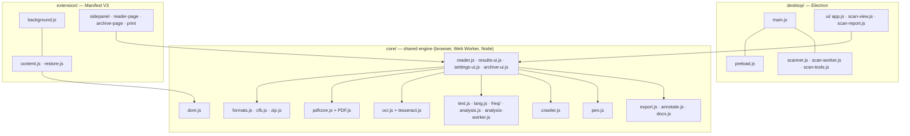
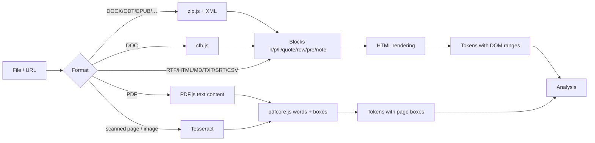
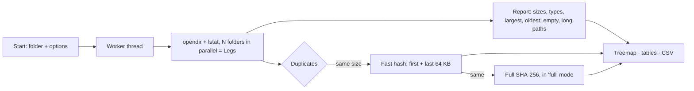

# Architecture

This document describes how Word Crawler is built: the shared engine, the two hosts that use it (the
desktop app and the browser extension), the algorithms, the disk scanner and the security model.

- [Overview](#overview)
- [Module map](#module-map)
- [Document pipeline](#document-pipeline)
- [Text analysis](#text-analysis)
- [The spider and the pen](#the-spider-and-the-pen)
- [Exports and archive](#exports-and-archive)
- [Desktop app](#desktop-app)
- [Disk scanner](#disk-scanner)
- [Browser extension](#browser-extension)
- [Performance](#performance)
- [Testing](#testing)

## Overview

The engine is plain JavaScript with no build step. Every `core/` module is an immediately invoked function
that attaches one global (`WCText`, `WCLang`, `WCAnalysis`, `WCEngine`, `WCFormats`, …) to `globalThis`,
so the same file can be loaded by a `<script>` tag, by `importScripts` in a Web Worker or service worker,
by `chrome.scripting.executeScript`, and by `require` in the Node test suites.

## Module map

| Module | Responsibility |
|---|---|
| `core/text.js` | Word normalisation, stopwords, sentence splitting, tokens |
| `core/lang.js` | Language data for it/en/fr/es/de/pt: detection, stopwords, abbreviations, definition patterns, readability formulas, stemming, German noun handling |
| `core/freq/*.js` | 20,000-word frequency ranks per language, loaded on demand |
| `core/analysis.js` | Keywords, summary, study marks, search, review cards, quiz, statistics |
| `core/analysis-worker.js` | Runs `analysis.js` in a Web Worker for long documents |
| `core/formats.js` | Converts every document format into a common block model |
| `core/cfb.js` | Compound File Binary reader for legacy Word 97–2003 `.doc` |
| `core/zip.js` | Minimal ZIP reader (stored, deflate, ZIP64) and writer (CRC-32, `CompressionStream`) |
| `core/pdfcore.js` | Words and positions from PDF.js text content |
| `core/ocr.js` | Tesseract OCR wrapper; maps recognised words onto the PDF word model |
| `core/dom.js` | Finds the main text of a web page and turns each word into a token with a lazy DOM range |
| `core/crawler.js` | The spider: canvas overlay, animation, marks, web, counters |
| `core/pen.js` | Hand-made marks: highlight, underline, notes, eraser |
| `core/reader.js` | The reader shared by both hosts: open, render, analyse, run the spider, collect results |
| `core/results-ui.js` | Results panel: summary, marks, keywords, review, statistics |
| `core/settings.js`, `settings-ui.js` | Modes, presets and parameters; each parameter declares its effect so the UI can explain it |
| `core/export.js` | Summary exports: Markdown, text, HTML, JSON, Anki; archive entries |
| `core/annotate.js`, `docx.js` | The marked-up document as HTML/PDF and as Word (.docx with comments) |
| `core/archive-ui.js` | Archive of saved readings |
| `desktop/main.js` | Electron main process: window, `app://` protocol, IPC, file dialogs, PDF printing |
| `desktop/preload.js` | The only bridge between the window and the system |
| `desktop/scanner.js`, `scan-worker.js` | Read-only disk scan in a worker thread |
| `desktop/scan-tools.js` | Scan comparison and the guarded "move duplicates to the Trash" action |
| `extension/background.js` | Service worker: toolbar action, shortcut, context menus, mark restoration |
| `extension/content.js` | The spider on web pages, driven by the side panel |

## Document pipeline

- **Common model.** Every non-PDF format becomes `{ format, title, blocks: [{ type, level?, text, runs? }], warnings }`,
  with bold/italic runs preserved where the source has them. The reader renders the blocks as HTML.
- **PDF.** Pages are rendered by PDF.js; `pdfcore.js` turns each page's viewport and text content into
  words with boxes in page coordinates, grouped in lines.
- **OCR.** A page with no text layer, or an image, is passed to tesseract.js (`createWorker(langs, 1, …)`,
  LSTM engine). The recognised words (TSV or block output, v5–v7) are converted into the same line/word
  model as PDF text, so the spider walks over the scanned page exactly as over a text PDF. The OCR
  language follows the document language setting (default Italian + English). Language data is
  downloaded once from jsDelivr and cached.
- **Encodings.** Plain text is decoded as UTF-8, UTF-16 (with BOM) or Windows-1252.

## Text analysis

All analysis is statistical and deterministic: the same document and settings always give the same result.

**Language.** Detection counts hits of the first 5,000 words against a characteristic word set per language;
it falls back to Italian when there is too little evidence. The user can also force a language.

**Keywords** (YAKE-style features combined with graph centrality):
- term frequency, frequency in headings, capitalisation away from sentence starts, spread across the text,
  context diversity (distinct left/right neighbours) and position of the first occurrence;
- rarity from the language's frequency list, so common words count less than rare ones;
- PageRank on a co-occurrence graph whose window is set by the **Legs** parameter;
- acronyms count as names; all-caps words do not; German common nouns are told apart from proper names.

**Summary** (extractive):
1. eligible sentences: complete, with at least four content words and a reasonable length;
2. relevance = 0.45 × TextRank on the sentence-similarity graph + 0.55 × keyword weight
   + a bonus for the first sentences of a paragraph (**Lead** parameter); very short and very long
   sentences, and sentences that open with a reference to a previous one ("This led to…"), are penalised;
3. selection with Maximal Marginal Relevance, with λ from the **Variety** parameter, so the same idea is not
   repeated; sentences are returned in document order, with leading connectives removed.

**Study marks.** Key sentences, definitions (per-language patterns such as "X is…", "X, cioè…",
"on appelle X…"), names, numbers and dates.

**Review.** Definition cards, fill-in-the-blank (cloze) cards built from key sentences, and a
multiple-choice quiz whose distractors are other terms of the same kind from the same document
(names with names, numbers with numbers). A seeded pseudo-random generator keeps the quiz stable for the
same document.

**Readability.** The formula fitting each language: Gulpease (it), Flesch Reading Ease (en),
Kandel–Moles (fr), Szigriszt–Pazos (es), Amstad (de), Flesch–Martins (pt).

## The spider and the pen

`crawler.js` never decides anything about the text. It receives analysed tokens and reveals them one at a
time at the chosen speed, drawing on a canvas overlay: the spider and its legs, the web between keywords,
boxes, circles, strike-throughs and sentence underlines, a veil over unread text and a counter panel.
Token rectangles are computed lazily from DOM ranges or PDF boxes, so very long documents do not
pay for layout up front. A `static` mode draws every mark at once (used for restored pages).

`pen.js` adds hand-made marks (`hl`, `under`, `note`) as token ranges. They are hit-tested through the
engine, drawn by the same overlay, listed in the results panel and saved in the archive.

## Exports and archive

- **Summary exports** (`export.js`): Markdown, plain text, HTML, JSON and a tab-separated Anki deck.
- **Marked-up document** (`annotate.js`, `docx.js`): HTML with the marks as styled spans; Word written as
  OOXML from scratch, with highlights and underlines as run properties and notes as Word comments;
  PDF printed from that HTML (desktop: hidden window with JavaScript disabled; extension: print page).
- **Archive**: saved readings with summary, marks, keywords, cards, settings and hand-made marks. The desktop
  app keeps it in the app's data folder; the extension in `chrome.storage.local`, with an index of saved
  web addresses used to restore marks.

## Desktop app

- One `BrowserWindow` with `contextIsolation: true`, `sandbox: true`, `nodeIntegration: false`.
- App files are served from an internal `app://` protocol restricted to a fixed list of folders
  (`core`, `desktop/ui`, PDF.js, Tesseract, icons), with a strict Content Security Policy.
- `preload.js` exposes a small API (`openFile`, `fetchUrl`, `saveFile`, `printPdf`, `settings`, `archive`,
  `scan`, `showItem`, `openExternal`, `info`, menu and file-open events). Every argument is validated in
  `main.js`: documents are read only from paths the user chose or passed to the app (300 MB at most),
  archive identifiers cannot leave the archive folder, CSV lists are copied only from the scans folder,
  and web addresses must be `http(s)`.
- Documents passed on the command line or by the operating system (file associations) open in the reader.

## Disk scanner

- **Read-only.** The scan uses only directory listing, `lstat` and read-only file handles. It never writes,
  moves, renames or deletes anything in the scanned folder, does not follow symbolic links or Windows
  junctions, and by default stays on the same device and skips hidden entries and system folders such as
  `$Recycle.Bin`, `System Volume Information`, `.Trashes`, `/proc` and `/sys`.
- **Duplicates** are grouped by size, then by a fast hash of the first and last 64 KB; in *full* mode
  candidates are confirmed with a SHA-256 of the whole file.
- **Treemap**: squarified layout (Bruls, Huizing, van Wijk), zoomable by folder.
- **Comparison** between two reports of the same folder: folders that grew or shrank and, when the CSV
  file list exists, files added, removed or changed.
- **Move duplicates to the Trash** (`scan-tools.js`) is a separate action, started only by the user, after a
  confirmation that lists every file. Before each move it checks that the file belongs to a duplicate
  group from that scan and lies inside the scanned folder; that at least one copy of the group remains
  and still exists with the same size; that the file is still a regular file (not a link) of the same
  size; and that its content is byte-for-byte identical to the kept copy (full SHA-256). Files go to the
  system Trash (`shell.trashItem`), never deleted, and every move is written to a log.

## Browser extension

- **Manifest V3**, permissions `activeTab`, `scripting`, `storage`, `unlimitedStorage`, `sidePanel`, `contextMenus`.
- **Side panel** drives the spider in the current tab: `background.js` injects the engine files listed in
  `content-list.js` plus the frequency list of the page language, then sends `wc:start` / `wc:toggle`.
- **Documents** (PDF, Word, images…) open in the extension's reader page instead of the tab.
- **Restored marks**: `restore.js` runs on every page and only sends the page address to the service
  worker; if the address is in the saved index, the engine is injected and the marks are drawn statically.
- No remote code: PDF.js and Tesseract are bundled by `scripts/build-extension.js`.

## Performance

- Analysis of long documents runs in a Web Worker; the page stays responsive.
- PDF pages are extracted in parallel with a bounded concurrency limit.
- DOM ranges and token rectangles are created lazily and cached.
- Keyword and sentence graphs are sparse; PageRank runs on adjacency lists.
- Reference figure: about 25,000 words read and analysed in 1.3 s.

## Testing

| Suite | Covers |
|---|---|
| `tests/analysis.test.js` | Analysis in six languages, keywords, summaries, definitions, cards, quiz, readability |
| `tests/formats.test.js` | Every document format from real files produced by LibreOffice and pandoc |
| `tests/export.test.js` | Summary exports and the Word/HTML marked-up document (Word files are unzipped and checked) |
| `tests/scanner.test.js` | Scanner results, read-only guarantee, comparison and every Trash safety rule |
| `tests/main.test.js` | Electron main process with a stubbed `electron` module: IPC validation, protocol, dialogs |
| `tests/reader.test.js` | The reader in Chromium with the real PDF.js, OCR mapping from recorded Tesseract output, the pen |
| `tests/extension.test.js` | The real extension loaded in Chromium: side panel, spider on a page, archive, restored marks |
| `tests/desktop-ui.test.js` | End-to-end run of the desktop UI with a real scan and screenshots |

`npm run lint` (`scripts/check.js`) runs before the tests and checks syntax, line endings, copyright
headers, JSON validity, version consistency between `package.json` and the extension manifest, the
changelog entry for the current version, and that every fixture referenced by the tests exists.
