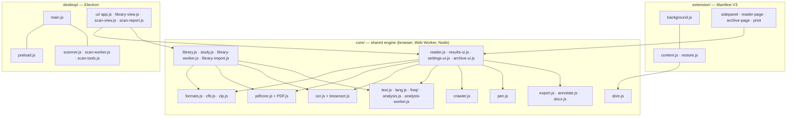
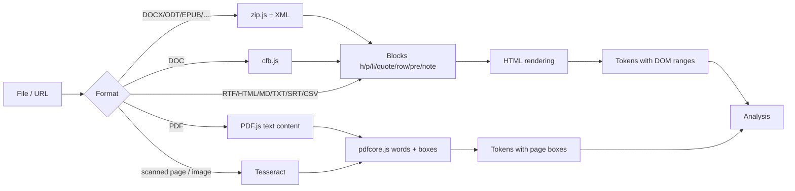
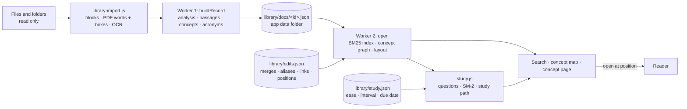
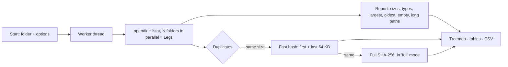

# Architecture

This document describes how Word Crawler is built: the shared engine, the two hosts that use it (the
desktop app and the browser extension), the algorithms, the disk scanner and the security model.

- [Overview](#overview)
- [Module map](#module-map)
- [Document pipeline](#document-pipeline)
- [Text analysis](#text-analysis)
- [The spider and the pen](#the-spider-and-the-pen)
- [Exports and archive](#exports-and-archive)
- [Library](#library)
- [Desktop app](#desktop-app)
- [Disk scanner](#disk-scanner)
- [Browser extension](#browser-extension)
- [Performance](#performance)
- [Testing](#testing)

## Overview

The engine is plain JavaScript with no build step. Every `core/` module is an immediately invoked function
that attaches one global (`WCText`, `WCLang`, `WCAnalysis`, `WCEngine`, `WCFormats`, …) to `globalThis`,
so the same file can be loaded by a `<script>` tag, by `importScripts` in a Web Worker or service worker,
by `chrome.scripting.executeScript`, and by `require` in the Node test suites.

## Module map

| Module | Responsibility |
|---|---|
| `core/text.js` | Word normalisation, stopwords, sentence splitting, tokens |
| `core/lang.js` | Language data for it/en/fr/es/de/pt: detection, stopwords, abbreviations, definition patterns, readability formulas, stemming, German noun handling |
| `core/freq/*.js` | 20,000-word frequency ranks per language, loaded on demand |
| `core/analysis.js` | Keywords, summary, study marks, search, review cards, quiz, statistics |
| `core/analysis-worker.js` | Runs `analysis.js` in a Web Worker for long documents |
| `core/formats.js` | Converts every document format into a common block model |
| `core/cfb.js` | Compound File Binary reader for legacy Word 97–2003 `.doc` |
| `core/zip.js` | Minimal ZIP reader (stored, deflate, ZIP64) and writer (CRC-32, `CompressionStream`) |
| `core/pdfcore.js` | Words and positions from PDF.js text content |
| `core/ocr.js` | Tesseract OCR wrapper; maps recognised words onto the PDF word model |
| `core/dom.js` | Finds the main text of a web page and turns each word into a token with a lazy DOM range |
| `core/crawler.js` | The spider: canvas overlay, animation, marks, web, counters |
| `core/pen.js` | Hand-made marks: highlight, underline, notes, eraser |
| `core/reader.js` | The reader shared by both hosts: open, render, analyse, run the spider, collect results |
| `core/results-ui.js` | Results panel: summary, marks, keywords, review, statistics |
| `core/settings.js`, `settings-ui.js` | Modes, presets and parameters; each parameter declares its effect so the UI can explain it |
| `core/export.js` | Summary exports: Markdown, text, HTML, JSON, Anki; archive entries |
| `core/annotate.js`, `docx.js` | The marked-up document as HTML/PDF and as Word (.docx with comments) |
| `core/archive-ui.js` | Archive of saved readings |
| `core/library.js` | Library engine: passages, concepts across documents, acronym merging, concept graph, BM25 search, user edits, Markdown export, map layout |
| `core/library-worker.js` | Runs the library and study engines in two Web Workers (one imports documents, one serves search, the graph and the questions) |
| `core/code.js` | Reads code: masks strings and comments, then finds functions, classes, variables, imports, endpoints, tables and TODOs per language family; call graph, dead code, syntax highlighting |
| `core/gamify.js` | Points, levels, badges and the day streak, all derived from the study log |
| `core/math.js` | A small LaTeX subset rendered to HTML, for formulas in cards and explanations |
| `core/pdfwrite.js` | Writes real annotations into a copy of a PDF, as an incremental update |
| `core/study.js` | Study engine: which concepts are worth knowing, questions from definitions and passages, answer matching, SM-2 schedule, mastery, study path, Anki export |
| `core/library-import.js` | Reads a file for the library: blocks, PDF words with their box on the page, OCR of scanned pages and images |
| `desktop/ui/library-view.js` | Library tab: import queue, document list, search results, concept map on canvas, concept page |
| `desktop/main.js` | Electron main process: window, `app://` protocol, IPC, file dialogs, PDF printing |
| `desktop/preload.js` | The only bridge between the window and the system |
| `desktop/scanner.js`, `scan-worker.js` | Read-only disk scan in a worker thread |
| `desktop/scan-tools.js` | Scan comparison and the guarded "move duplicates to the Trash" action |
| `extension/background.js` | Service worker: toolbar action, shortcut, context menus, mark restoration |
| `extension/content.js` | The spider on web pages, driven by the side panel |

## Document pipeline

- **Common model.** Every non-PDF format becomes `{ format, title, blocks: [{ type, level?, text, runs? }], warnings }`,
  with bold/italic runs preserved where the source has them. The reader renders the blocks as HTML.
- **PDF.** Pages are rendered by PDF.js; `pdfcore.js` turns each page's viewport and text content into
  words with boxes in page coordinates, grouped in lines.
- **OCR.** A page with no text layer, or an image, is passed to tesseract.js (`createWorker(langs, 1, …)`,
  LSTM engine). The recognised words (TSV or block output, v5–v7) are converted into the same line/word
  model as PDF text, so the spider walks over the scanned page exactly as over a text PDF. The OCR
  language follows the document language setting (default Italian + English). Language data is
  downloaded once from jsDelivr and cached.
- **Encodings.** Plain text is decoded as UTF-8, UTF-16 (with BOM) or Windows-1252.

## Text analysis

All analysis is statistical and deterministic: the same document and settings always give the same result.

**Language.** Detection counts hits of the first 5,000 words against a characteristic word set per language;
it falls back to Italian when there is too little evidence. The user can also force a language.

**Keywords** (YAKE-style features combined with graph centrality):
- term frequency, frequency in headings, capitalisation away from sentence starts, spread across the text,
  context diversity (distinct left/right neighbours) and position of the first occurrence;
- rarity from the language's frequency list, so common words count less than rare ones;
- PageRank on a co-occurrence graph whose window is set by the **Legs** parameter;
- acronyms count as names; all-caps words do not; German common nouns are told apart from proper names.

**Summary** (extractive):
1. eligible sentences: complete, with at least four content words and a reasonable length;
2. relevance = 0.45 × TextRank on the sentence-similarity graph + 0.55 × keyword weight
   + a bonus for the first sentences of a paragraph (**Lead** parameter); very short and very long
   sentences, and sentences that open with a reference to a previous one ("This led to…"), are penalised;
3. selection with Maximal Marginal Relevance, with λ from the **Variety** parameter, so the same idea is not
   repeated; sentences are returned in document order, with leading connectives removed.

**Study marks.** Key sentences, definitions (per-language patterns such as "X is…", "X, cioè…",
"on appelle X…"), names, numbers and dates.

**Review.** Definition cards, fill-in-the-blank (cloze) cards built from key sentences, and a
multiple-choice quiz whose distractors are other terms of the same kind from the same document
(names with names, numbers with numbers). A seeded pseudo-random generator keeps the quiz stable for the
same document.

**Readability.** The formula fitting each language: Gulpease (it), Flesch Reading Ease (en),
Kandel–Moles (fr), Szigriszt–Pazos (es), Amstad (de), Flesch–Martins (pt).

## The spider and the pen

`crawler.js` never decides anything about the text. It receives analysed tokens and reveals them one at a
time at the chosen speed, drawing on a canvas overlay: the spider and its legs, the web between keywords,
boxes, circles, strike-throughs and sentence underlines, a veil over unread text and a counter panel.
Token rectangles are computed lazily from DOM ranges or PDF boxes, so very long documents do not
pay for layout up front. A `static` mode draws every mark at once (used for restored pages).

`pen.js` adds hand-made marks (`hl`, `under`, `note`) as token ranges. They are hit-tested through the
engine, drawn by the same overlay, listed in the results panel and saved in the archive.

## Exports and archive

- **Summary exports** (`export.js`): Markdown, plain text, HTML, JSON and a tab-separated Anki deck.
- **Marked-up document** (`annotate.js`, `docx.js`): HTML with the marks as styled spans; Word written as
  OOXML from scratch, with highlights and underlines as run properties and notes as Word comments;
  PDF printed from that HTML (desktop: hidden window with JavaScript disabled; extension: print page).
- **Archive**: saved readings with summary, marks, keywords, cards, settings and hand-made marks. The desktop
  app keeps it in the app's data folder; the extension in `chrome.storage.local`, with an index of saved
  web addresses used to restore marks.

## Library

The Library (desktop app) turns many documents into one local knowledge base. Everything is statistical and
computed on the user's computer.

**Brains.** A brain is a library of its own: `library/b/<id>/` holds its `docs/`, `trash/`, `edits.json` and
`study.json`, and `library/brains.json` holds the index (name, icon, colour, tags, dates) and which one is
open. The main process resolves every library path through the open brain, so the rest of the engine needs
no notion of brains at all; switching one clears the set of authorised paths, so a brain can only reach the
files that were added to it. A library written by an earlier version is moved into the first brain at the
first start. Export writes a `word-crawler-brain` JSON with the records, the map edits and the study state;
import keeps only records whose id still matches the SHA-256 of the path they carry. Deleting a brain moves
its folder to `library/b-trash/`, and the last brain cannot be deleted.

**Import.** The main process lists folders recursively without following links, skipping hidden entries,
Office temporary files, programs and images (images can be added one by one), and reads only files the user
chose. Each file gets an id derived from its path and a SHA-256 fingerprint: unchanged files are skipped,
identical copies under another name are reported, and files changed or missing on disk are flagged in the
list. Records are written atomically; removing a document moves its record to `library/trash` for 30 days
(the original file is never touched).

**Passages.** The analysed tokens are grouped by block: headings become their own passage and the *section*
of the following ones; consecutive list items or table rows are merged up to 90 words; paragraphs longer
than 220 words are split at sentence boundaries into pieces of about 150 words. Each passage stores its
page (and last page), slide number, section and, for PDF and OCR pages, the union of its word boxes as
fractions of the page.

**Concepts of a document.** Candidates are the document's keywords (`analysis.js`), names, terms found in
definitions and acronyms. An acronym is matched to its long form when the initials of the words before or
inside the parentheses spell it, skipping stopwords: "Quadrature Amplitude Modulation (QAM)",
"Ministero della Salute (MS)", "NATO (North Atlantic Treaty Organization)". A concept's key is the sequence
of word stems of its content words in the document's language, so singular, plural and inflected forms
share one key. Weak candidates (a single word seen once that is not a name, acronym or defined term) are
dropped; at most 70 concepts per document are kept, plus all defined terms and acronyms.

**One graph for all documents.**
1. Keys that are equal across documents are one concept. Acronym pairs written in the text are merged with
   a union-find; so are the merges confirmed by the user, unless the user separated them.
2. Every concept is searched in **every** passage of the library (sequence match on stems), so a term is
   found even in documents where the analysis did not select it. A concept that only ever appears inside a
   longer one ("Amplitude Modulation" inside "Quadrature Amplitude Modulation") is not a node of its own.
3. Links: concepts in the same passages, weighted by `c / sqrt(nA · nB)` (co-occurrences over the geometric
   mean of their passage counts); kept when they co-occur at least twice or the weight is at least 0.5, and
   at most 8 per concept. Definitions add typed links: the first concept within a few words after the
   copula ("is a", "è una", "est un", "ist ein"…) gives *is a type of*; the others *used in the definition*.
4. Importance: weighted PageRank on the links; the top 10% are *central*. A concept in two or more documents
   is *multi-document*.
5. Suggestions, never applied automatically: an acronym whose letters match the initials of another
   concept, labels that differ only in spaces, hyphens or accents, and labels within edit distance 2.

**Search.** Each passage is indexed by `language:stem` terms (hyphenated words also by their parts, short
upper-case acronyms included). Ranking is BM25 (k1 = 1.2, b = 0.75), multiplied by the share of query
words found in the passage. If the query or part of it is the name or an alias of a concept, the passages
of that concept get a boost and its other forms are highlighted too. Quoted phrases must appear verbatim.
Question words of natural queries ("dove ho parlato di…", "where did I…") are ignored. Filters: documents,
languages, file types, dates, a concept.

**User edits** are stored separately (`library/edits.json`) and re-applied every time the graph is rebuilt:
merges, separations, rejected suggestions, labels, aliases, manual links, removed links and pinned map
positions, each with a history entry.

**Map layout.** Force-directed: springs on the links and repulsion between nearby nodes through a spatial
grid, so the cost grows almost linearly; pinned nodes stay where the user put them. About 2 s for 5,000
concepts and 15,000 links.

**A map that keeps moving.** The worker's layout is the starting point, not the final word: the renderer runs
a light version of the same forces every frame and never lets the simulation freeze (the energy decays to a
floor instead of to zero, and a per-node sine adds a one-pixel breath). Only the nodes inside the viewport
are simulated, at most 900 per frame and in rotation beyond that, so a map of thousands of concepts costs the
same as a small one. Dragging a node pins it and pushes its neighbours; the camera follows a target transform
with exponential easing and keeps scrolling after a flick. The loop stops when the map is hidden or the window
is in the background, and `prefers-reduced-motion` (or the system setting changing mid-session) replaces it
with a static draw.

**Open at the exact position.** The Reader opens the file, completes the reading at once, finds the passage
by its first words (and page, for PDFs), scrolls to it and highlights it for a few seconds.

## Study

`core/study.js` adds the "how well do I know this" layer on top of the same graph, in the same worker. It
generates nothing: every question is assembled from text the library already extracted, and carries the
document, page and slide it came from.

**Which concepts are asked about.** A concept qualifies if it has a definition, is an acronym, is a proper
name seen in several documents or at least three times, or is a multi-word term seen at least twice; a
frequent single word qualifies only if it is central and appears in several documents. This keeps verbs and
chapter titles out of the deck.

**Question types**, in order of preference: *definition* (term → definition), *cloze* (the definition with
every form of the term blanked out), *is a type of* (from the typed relation of the graph) and *use* (a
sentence between 50 and 320 characters where the concept appears, with the concept removed). Blanking matches
on stems, so "modulazioni" is blanked for the concept "modulazione". The card shown is chosen by the number
of answers already given for that concept, so the same concept rotates through its questions.

**Typed answers** are compared after folding accents and punctuation, then by stem sequence, then by edit
distance (2 for terms of 8 characters or more, otherwise 1). A match grades *good*, a miss grades *again*;
the user can still override with "I did know it".

**Schedule (SM-2).** Each concept keeps `ease` (1.3–2.8), `interval` in days, `due`, `reps`, `lapses` and
`seen`. First correct answers give 1, 2 or 4 days, then 3, 6 or 8, then `interval × ease` adjusted by the
grade; a lapse resets `reps`, lowers the ease by 0.2 and returns the concept the next day. Mastery is
`log(1 + interval) / log(1 + 21)` penalised by the share of lapses (at most 60%), floored at 0.02 for
anything seen at least once — "forgotten" and "never seen" must not look the same on the map.

**Study path.** The *is a type of* edges form a forest; a concept's level is its distance from the root
(cycles are cut after 12 steps). Concepts are sorted by level, then central first, then by PageRank. The same
order drives the session (due concepts first, oldest due first, then new ones along the path) and the Anki
export.

**Identity across edits.** Progress is keyed by concept stem, and a concept is looked up by any of its
members, so merging, splitting or renaming concepts never loses a review history. State lives in
`library/study.json`, separate from the map edits, and is written after a short debounce.

## Writing into a PDF

`core/pdfwrite.js` adds real annotations — highlights, underlines, strike-outs, boxes and sticky notes
— to a copy of the original PDF, with no library. It uses an **incremental update**, the mechanism the
format itself provides: the original bytes are left untouched and the file grows by the new annotation
objects, a rewritten copy of each touched page with its `/Annots` extended, a small `xref` table and a
trailer whose `/Prev` points at the previous one. Readers show the latest version; the earlier one is
still in the file.

Objects are found by scanning for `N G obj` headers, and the page list by walking `/Root → /Pages →
/Kids`. That covers PDFs whose pages are ordinary objects. When the pages live inside compressed object
streams, or the file is encrypted, nothing can be appended without rewriting the whole document: the
module says so and the Reader falls back to printing a new marked PDF. Text is written as UTF-16BE so
accents survive, quad points come from PDF.js's `convertToPdfPoint`, so a rotated page still lands
right.

## Comparing two versions

`versions(a, b)` matches **passages**, not lines, so a reformatted document does not read as entirely
changed: identical passages pair first, then those sharing more than 60% of their words, in order. What
is left over is "gone" on one side and "new" on the other. `versionPairs()` guesses which documents are
versions of the same thing by stripping version words and numbers from their names.

## Desktop app

- One `BrowserWindow` with `contextIsolation: true`, `sandbox: true`, `nodeIntegration: false`.
- App files are served from an internal `app://` protocol restricted to a fixed list of folders
  (`core`, `desktop/ui`, PDF.js, Tesseract, icons), with a strict Content Security Policy.
- `preload.js` exposes a small API (`openFile`, `fetchUrl`, `saveFile`, `printPdf`, `settings`, `archive`,
  `library`, `scan`, `showItem`, `openExternal`, `info`, menu and file-open events). Every argument is validated in
  `main.js`: documents are read only from paths the user chose or passed to the app (300 MB at most),
  archive identifiers cannot leave the archive folder, CSV lists are copied only from the scans folder,
  library files can be read only if the user added them (or they are already in the library), library
  records must match the id of their path, and web addresses must be `http(s)`.
- Documents passed on the command line or by the operating system (file associations) open in the reader.

## Disk scanner

- **Read-only.** The scan uses only directory listing, `lstat` and read-only file handles. It never writes,
  moves, renames or deletes anything in the scanned folder, does not follow symbolic links or Windows
  junctions, and by default stays on the same device and skips hidden entries and system folders such as
  `$Recycle.Bin`, `System Volume Information`, `.Trashes`, `/proc` and `/sys`.
- **Duplicates** are grouped by size, then by a fast hash of the first and last 64 KB; in *full* mode
  candidates are confirmed with a SHA-256 of the whole file.
- **Treemap**: squarified layout (Bruls, Huizing, van Wijk), zoomable by folder.
- **Comparison** between two reports of the same folder: folders that grew or shrank and, when the CSV
  file list exists, files added, removed or changed.
- **Move duplicates to the Trash** (`scan-tools.js`) is a separate action, started only by the user, after a
  confirmation that lists every file. Before each move it checks that the file belongs to a duplicate
  group from that scan and lies inside the scanned folder; that at least one copy of the group remains
  and still exists with the same size; that the file is still a regular file (not a link) of the same
  size; and that its content is byte-for-byte identical to the kept copy (full SHA-256). Files go to the
  system Trash (`shell.trashItem`), never deleted, and every move is written to a log.

## Browser extension

- **Manifest V3**, permissions `activeTab`, `scripting`, `storage`, `unlimitedStorage`, `sidePanel`, `contextMenus`.
- **Side panel** drives the spider in the current tab: `background.js` injects the engine files listed in
  `content-list.js` plus the frequency list of the page language, then sends `wc:start` / `wc:toggle`.
- **Documents** (PDF, Word, images…) open in the extension's reader page instead of the tab.
- **Restored marks**: `restore.js` runs on every page and only sends the page address to the service
  worker; if the address is in the saved index, the engine is injected and the marks are drawn statically.
- No remote code: PDF.js and Tesseract are bundled by `scripts/build-extension.js`.

## Performance

- Analysis of long documents runs in a Web Worker; the page stays responsive.
- PDF pages are extracted in parallel with a bounded concurrency limit.
- DOM ranges and token rectangles are created lazily and cached.
- Keyword and sentence graphs are sparse; PageRank runs on adjacency lists.
- Reference figure: about 25,000 words read and analysed in 1.3 s.
- Library: import and analysis in one worker, index and graph in another; search over 3,000 passages in
  about 15 ms; graph of a few thousand passages in well under a second; map layout of 5,000 concepts in about 2 s.

## Testing

| Suite | Covers |
|---|---|
| `tests/analysis.test.js` | Analysis in six languages, keywords, summaries, definitions, cards, quiz, readability |
| `tests/formats.test.js` | Every document format from real files produced by LibreOffice and pandoc |
| `tests/export.test.js` | Summary exports and the Word/HTML marked-up document (Word files are unzipped and checked) |
| `tests/scanner.test.js` | Scanner results, read-only guarantee, comparison and every Trash safety rule |
| `tests/main.test.js` | Electron main process with a stubbed `electron` module: IPC validation, protocol, dialogs |
| `tests/library.test.js` | Library engine: passages, acronyms, concepts across documents, graph and relations, suggestions, search, every user edit, Markdown export, performance |
| `tests/code.test.js` | Reading code: symbols and exact lines per language, imports, calls, dead code across files, strings and comments not confusing the parser, complexity, notebooks, and code inside the brain |
| `tests/insights.test.js` | Gaps, contradictions, doc/code drift, isolated concepts, "explain" with its sources, comparing two brains |
| `tests/pdfwrite.test.js` | Annotations written into a PDF: original bytes untouched, every subtype, accents, and PDF.js reading them back; comparing two versions of a document |
| `tests/study.test.js` | Study engine: blanking with stems, answer matching, SM-2 intervals and mastery, questions with their sources, rotation, study path, per-document filter, survival across merges, reset, Anki export |
| `tests/library-ui.test.js` | The Library tab in Chromium with the real workers and PDF.js: folder import (Word, PowerPoint, PDF, scanned PDF), search, open at position, map, concept page, merge, rename, links, exports, undo, a full study session (typed answer, grading, keyboard, saved progress), the map coloured by mastery and actually moving, Anki export |
| `tests/reader.test.js` | The reader in Chromium with the real PDF.js, OCR mapping from recorded Tesseract output, the pen |
| `tests/extension.test.js` | The real extension loaded in Chromium: side panel, spider on a page, archive, restored marks |
| `tests/desktop-ui.test.js` | End-to-end run of the desktop UI with a real scan and screenshots |

`npm run lint` (`scripts/check.js`) runs before the tests and checks syntax, line endings, copyright
headers, JSON validity, version consistency between `package.json` and the extension manifest, the
changelog entry for the current version, and that every fixture referenced by the tests exists.
